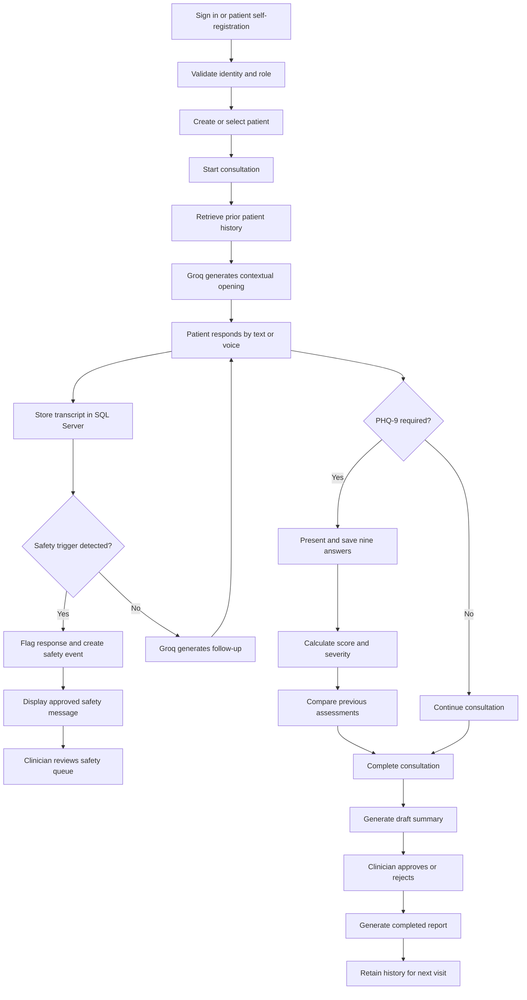
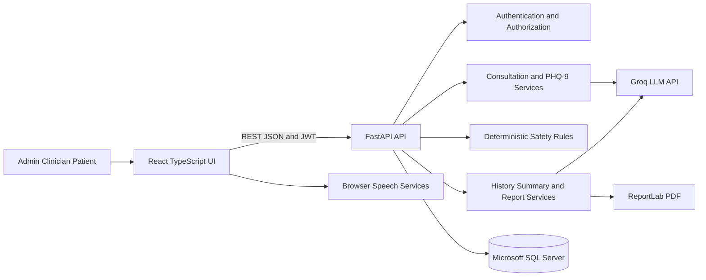

# Continuum Patient Follow-up AI Agent

## Business Requirements Document

| Field | Value |
|---|---|
| Project | Continuum Patient Follow-up AI Agent |
| Version | 1.0 |
| Status | Draft |
| Application type | Healthcare follow-up prototype |

## 1. Executive Summary

Continuum is an AI-powered patient follow-up platform for maintaining consultation history, conducting PHQ-9 assessments, comparing patient progress, identifying safety concerns, and supporting clinician review. It combines deterministic clinical workflow rules with Groq-generated conversational responses.

The application is not a general chatbot, diagnostic system, medical device, or emergency service. Clinical decisions remain the responsibility of qualified professionals.

## 2. Business Problem

Patient follow-up information is often distributed across visits and difficult to compare. Clinicians may need to repeat questions, calculate assessment scores manually, review lengthy conversations, and identify concerning responses without a centralized workflow. Patients may also lack a convenient way to participate remotely or review completed consultations.

Continuum addresses these issues by preserving patient-specific history and combining structured assessments, contextual conversations, safety rules, clinician oversight, and patient reports in one application.

## 3. Business Objectives

- Maintain a longitudinal history for every patient.
- Personalize follow-up conversations using previous visits.
- Digitize PHQ-9 administration, validation, scoring, and comparison.
- Detect defined concerning responses immediately.
- Provide a structured clinician safety-review process.
- Support patient interaction through text and browser-based voice.
- Generate reviewable summaries and downloadable PDF reports.
- Protect patient records with role-based access and audit logging.

## 4. Stakeholders and Roles

| Role | Responsibilities and access |
|---|---|
| Administrator | System-wide oversight, user administration, access to all patients, summaries, and safety events |
| Clinician | Manage assigned patients, start consultations, review history, approve summaries, and handle safety events |
| Patient | Access only their own record, participate in consultations and assessments, and download completed reports |
| Clinical governance team | Approve questionnaires, escalation messages, workflows, and clinical boundaries |
| Security and compliance team | Approve privacy, security, retention, consent, and production controls |
| Development team | Develop, test, deploy, monitor, and maintain the application |

## 5. Scope

### In Scope

- JWT authentication and role-based authorization.
- Administrator, clinician, and patient accounts.
- Patient registration and portal account creation.
- Patient-specific consultation history.
- AI-generated openings and follow-up questions.
- Persistent text and voice transcripts.
- Browser speech recognition and speech synthesis.
- PHQ-9 question delivery, validation, scoring, and history.
- Deterministic safety-event creation.
- Clinician summary and safety review.
- PDF consultation reports.
- Audit logging and SQL Server persistence.

### Out of Scope

- Autonomous diagnosis or treatment recommendations.
- Automatic emergency-service contact.
- EHR, insurance, billing, or medication integration.
- Native mobile applications.
- Complete clinical de-identification.
- Replacement of professional clinical judgment.

## 6. Functional Requirements

| ID | Requirement |
|---|---|
| FR-01 | The system shall authenticate users with username and password and issue a JWT access token. |
| FR-02 | The backend shall enforce administrator, clinician, and patient access boundaries. |
| FR-03 | Patients shall be able to self-register or use clinician-created portal credentials. |
| FR-04 | Clinicians shall be able to create and view their assigned patients. |
| FR-05 | Each patient shall have a unique public identifier. |
| FR-06 | The system shall permit only one active consultation per patient. |
| FR-07 | A new consultation shall retrieve relevant previous assessments, statements, and approved summaries. |
| FR-08 | Groq shall generate contextual opening and follow-up questions. |
| FR-09 | Every message shall be stored with its consultation, role, sequence, flag, and timestamp. |
| FR-10 | Patients shall be able to communicate through text or supported browser voice services. |
| FR-11 | The backend shall provide the approved nine-question PHQ-9 instrument. |
| FR-12 | Assessment answers shall be validated as scores from zero through three. |
| FR-13 | The system shall calculate a total score from zero through 27 and assign severity. |
| FR-14 | Every assessment shall be stored separately without overwriting previous visits. |
| FR-15 | The system shall provide current and previous assessment comparisons. |
| FR-16 | A positive PHQ-9 question 9 answer shall create a safety event. |
| FR-17 | Configured concerning chat language shall flag the message and create a safety event. |
| FR-18 | Clinicians shall be able to acknowledge and resolve permitted safety events. |
| FR-19 | Completing a consultation shall create a draft summary linked to source messages. |
| FR-20 | Clinicians shall be able to approve or reject consultation summaries. |
| FR-21 | Approved summaries shall be available as context for future consultations. |
| FR-22 | The system shall generate a PDF report for an authorized completed consultation. |
| FR-23 | Reports shall exclude complete chat and audio transcripts. |
| FR-24 | Authentication and clinical workflow actions shall be auditable. |
| FR-25 | Conversational endpoints shall return a service error when Groq is unavailable rather than generating a scripted substitute. |

## 7. End-to-End Workflow

## 8. Detailed Process Flows

### Authentication and Account Flow

1. The first account is created through the bootstrap process while the user table is empty.
2. Existing users sign in using OAuth2-compatible username and password submission.
3. Passwords are verified against Argon2 hashes.
4. The backend issues an HS256 JWT containing the user ID, role, and expiry.
5. The frontend sends the token as a bearer token with protected requests.
6. Patient self-registration creates both a patient record and linked patient user account.

### Consultation and AI Flow

1. An authorized user starts a consultation for a patient.
2. A database constraint prevents multiple active consultations for that patient.
3. The history service retrieves recent assessments, approved summaries, and relevant previous statements.
4. Groq generates one contextual opening question.
5. Patient or clinician messages are stored before response generation.
6. The backend scans patient content for deterministic safety phrases.
7. If safe, Groq uses patient memory and recent messages to generate the next question.
8. A repetition guard reduces questions that are too similar to earlier questions.
9. Completing the consultation records its end time and creates a draft summary.

### PHQ-9 Flow

1. An assessment is created within an active consultation.
2. The nine approved questions are presented in numerical order.
3. Each answer is validated and stored with its score and answer text.
4. Duplicate answers to the same assessment question are prohibited.
5. A question 9 score greater than zero creates a safety event.
6. After all answers are received, the backend calculates the total and severity.
7. The completed assessment becomes part of future consultation history.

### Safety Flow

1. A positive PHQ-9 question 9 answer or configured concerning phrase triggers escalation.
2. The message or answer is linked to a new open safety event.
3. The consultation is marked as requiring review.
4. The patient receives an approved immediate-support message.
5. The permitted clinician or administrator reviews the event and context.
6. The event moves from open to acknowledged or resolved.
7. The status change and responsible user are audited.

### Summary and Report Flow

1. Consultation completion produces a draft summary from stored patient and clinician messages.
2. A clinician approves or rejects the summary.
3. Approved summaries are included in future patient memory.
4. For a completed consultation, Groq extracts structured symptom findings from the transcript.
5. ReportLab creates a PDF containing patient details, assessment results, symptom findings, approved summary, and disclaimer.
6. Full transcripts and audio are excluded from the report.

## 9. Business Rules

- A user may access only records allowed by their role and patient association.
- Only one active consultation may exist for a patient.
- PHQ-9 questions must use approved wording and scores from zero through three.
- PHQ-9 total scores must remain between zero and 27.
- Question 9 scores above zero always require review.
- Safety decisions must not rely solely on a general-purpose LLM.
- Completed assessments and consultations must remain available for historical comparison.
- AI output must not be presented as a diagnosis or treatment decision.
- Only approved summaries may be used as trusted summary context in later visits.

## 10. Technology Stack

### Frontend

| Technology | Purpose |
|---|---|
| React 19 | Component-based user interface |
| TypeScript 5.9 | Static type checking |
| Vite 7 | Development server and production build |
| Axios 1.12 | REST API communication |
| Lucide React | Interface icons |
| React Router DOM | Installed routing library |
| Recharts | Installed charting library |
| CSS | Responsive application styling |
| Web Speech API | Browser speech-to-text transcription |
| Speech Synthesis API | Browser playback of agent responses |
| ESLint 9 | Frontend static analysis |

### Backend

| Technology | Purpose |
|---|---|
| Python | Backend programming language |
| FastAPI | REST API framework and OpenAPI documentation |
| Uvicorn | ASGI development/application server |
| SQLAlchemy 2 | Object-relational mapping and database access |
| Alembic | Database schema migrations |
| pyODBC | Microsoft SQL Server connectivity |
| Pydantic Settings | Environment-based configuration |
| python-jose | JWT encoding and validation |
| pwdlib with Argon2 | Password hashing |
| Groq SDK | LLM request integration |
| HTTPX | HTTP client support |
| ReportLab | PDF document generation |
| PyPDF | PDF processing and verification |
| Pytest and pytest-asyncio | Automated backend testing |

### Data and Infrastructure

| Technology | Purpose |
|---|---|
| Microsoft SQL Server | Relational application data storage |
| ODBC Driver 18 | SQL Server connection driver |
| Environment variables | Database, JWT, Groq, account, and CORS configuration |
| REST and JSON | Frontend-to-backend communication |
| JWT bearer tokens | Authenticated API access |

## 11. System Architecture

## 12. Core Data Model

| Entity | Purpose |
|---|---|
| User | Stores credentials, role, status, and optional patient association |
| Patient | Stores identity, public identifier, creator, and active status |
| Consultation | Stores patient, clinician, lifecycle status, timing, and review flag |
| Message | Stores ordered conversation content, role, session, timestamp, and safety flag |
| Assessment | Stores PHQ-9 status, total score, severity, and timing |
| Assessment Answer | Stores each question, answer text, and numerical score |
| Consultation Summary | Stores summary content, message sources, review state, and reviewer |
| Safety Event | Stores trigger reason, action, lifecycle state, and acknowledgment data |
| Audit Log | Stores actor, action, entity, details, and timestamp |

## 13. Integration Requirements

### Groq

- Generate personalized opening and follow-up questions.
- Use recent messages and selected patient history as context.
- Extract symptom findings for completed-consultation reports.
- Return a service error when the API key is missing or the provider is unavailable.
- Remove common email and phone patterns before sending content, while recognizing that this is not complete de-identification.

### Browser Voice Services

- Use `SpeechRecognition` or `webkitSpeechRecognition` for transcription.
- Store the resulting transcript as a normal consultation message.
- Use speech synthesis to read agent responses.
- Do not store captured or generated audio.
- Require organizational approval because browser or operating-system services may process audio.

### SQL Server

- Store users, patients, consultations, messages, assessments, summaries, safety events, and audits.
- Enforce foreign keys, allowed status values, score ranges, and one active consultation per patient.
- Manage schema changes through Alembic migrations.

## 14. Security, Privacy, and Clinical Safety

- Passwords must be stored using Argon2 hashes.
- Protected endpoints must validate JWT bearer tokens.
- Backend authorization must prevent cross-patient access.
- Production secrets must not use development defaults.
- Production communication must use HTTPS.
- Patient data must not be sent to an AI provider without approved data-handling agreements.
- Development and testing should use synthetic patient data.
- Consent, retention, encryption, deletion, and breach-response policies require organizational approval.
- The application must display that it is not an emergency service.
- Clinical escalation wording and procedures must be approved before real-patient use.

## 15. Non-Functional Requirements

| Category | Requirement |
|---|---|
| Usability | The interface shall support common desktop and mobile browser sizes. |
| Reliability | Stored consultations and assessments shall remain available across sessions. |
| Integrity | Database constraints shall protect relationships, allowed states, and score ranges. |
| Security | Every protected operation shall enforce server-side authorization. |
| Maintainability | Routers, services, models, schemas, migrations, and tests shall remain separated. |
| Auditability | Important authentication and clinical workflow actions shall be traceable. |
| Failure handling | Provider and validation failures shall return clear errors without fabricated clinical content. |
| Testability | PHQ-9 scoring, accounts, agent behavior, reporting, and schemas shall support automated testing. |

## 16. Assumptions, Dependencies, and Constraints

- Microsoft SQL Server and ODBC Driver 18 are available.
- A valid Groq API key is required for conversational features and report extraction.
- Voice functionality depends on browser and operating-system support.
- The current implementation is a prototype and not a certified medical device.
- There is no automatic emergency-service routing or external notification system.
- The safety-language detector uses configured deterministic phrases and is not comprehensive semantic triage.
- There is no password reset, multi-factor authentication, or native mobile application.
- Production use requires clinical, legal, security, and privacy approval.

## 17. Acceptance Criteria

1. Users can authenticate and access only records permitted by their role.
2. A clinician or patient can create a valid patient portal account through an allowed flow.
3. A consultation can retrieve relevant previous patient history.
4. Groq can generate context-aware opening and follow-up questions.
5. Conversation messages persist in the correct order.
6. Voice input produces a stored transcript and the agent response can be spoken.
7. Nine valid PHQ-9 answers produce the correct score and severity.
8. A new assessment does not overwrite an earlier assessment.
9. Positive question 9 answers and configured concerning phrases create safety events.
10. Authorized clinicians can acknowledge and resolve safety events.
11. Consultation completion creates a reviewable draft summary.
12. Approved summaries are available to future consultations.
13. A completed consultation can produce an authorized PDF report without a full transcript.
14. Important workflow actions produce audit records.
15. Backend tests, frontend linting, and frontend production builds pass.

