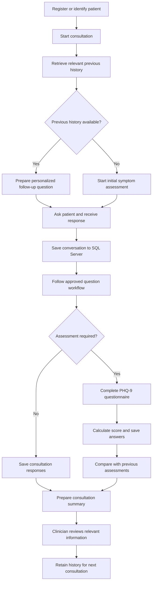

# Patient Follow-up AI Agent — Project Workflow

## 1. Project Objective

The objective is to develop an AI-powered patient follow-up system that remembers previous consultations, asks patients about previously reported symptoms, conducts follow-up assessments such as PHQ-9, stores conversation history, and helps clinicians understand changes in a patient's condition over time.

The system should not behave like a general chatbot. It should maintain patient-specific history and use that history to make each new consultation more relevant.

## 2. How the Complete Project Should Work

### Step 1: Patient Registration

- The clinician registers a new patient in the application.
- The system generates a unique patient ID.
- Patient details are stored in SQL Server.
- The patient can then participate in consultations associated with that ID.

**Output:** A patient profile is created.

### Step 2: Start the First Consultation

- The clinician starts a new consultation for the patient.
- The system creates a consultation record linked to the patient ID.
- The AI agent welcomes the patient and begins the approved questionnaire or symptom assessment.
- The agent asks one question at a time and waits for the patient's response.

**Example:**

Agent: “How have you been feeling recently?”

Patient: “I have been feeling tired and having trouble sleeping.”

Agent: “How often have you experienced these problems over the past two weeks?”

The agent continues according to the configured questionnaire or follow-up workflow.

### Step 3: Conduct the PHQ-9 Assessment

- The agent presents the nine PHQ-9 questions using the approved wording.
- The patient selects an answer for each question.
- Each answer is assigned a value from 0 to 3.
- The backend validates and stores each answer in SQL Server.
- Once all nine answers are complete, Python calculates the total score.
- The assessment, score, date, and individual answers are stored against the consultation.

**Output:** A completed assessment is available for future comparison and clinician review.

### Step 4: Store the Conversation History

Every interaction between the patient and the agent should be saved in SQL Server.

The stored information should include:

- Patient ID and consultation ID.
- Chat session ID.
- Patient messages.
- AI agent responses.
- Message timestamps.
- Assessment answers and results.
- Relevant consultation summaries and their source.
- Review or approval status where applicable.

Each new consultation must create new records rather than overwrite previous assessments.

**Output:** The system has a persistent history for each patient.

### Step 5: Patient Returns for Another Consultation

When the same patient returns, the system should identify the patient through an authenticated workflow and retrieve the relevant previous consultation information.

The history service should find:

- The most recent completed assessment.
- Previously reported symptoms.
- Previous answers and assessment scores.
- Relevant clinician-reviewed notes.
- Any follow-up items that remain applicable.

The system should use this information to prepare the opening question for the new consultation.

**Example:**

Previous consultation:
- The patient reported feeling tired.
- The patient reported trouble sleeping.
- A PHQ-9 assessment was completed.

New consultation:

Agent: “During your previous consultation, you mentioned feeling tired and having trouble sleeping. How have these symptoms been over the past two weeks?”

**Output:** The agent begins the new consultation using relevant information from the previous visit.

### Step 6: Understand the Patient's Response

The patient may report that the condition has improved, worsened, remained the same, or changed in some other way.

For example:

Patient: “My sleep has improved, but I still feel tired.”

The agent should:

1. Record the patient's response.
2. Identify which previously reported symptoms the response concerns.
3. Ask the next relevant question from the approved follow-up workflow.
4. Avoid asking questions that have already been answered unnecessarily.
5. Store the new messages and responses.

The LLM can help interpret natural language and phrase conversational questions. Deterministic backend logic should manage assessment scoring, data validation, and the formal question sequence.

### Step 7: Conduct the New Assessment

If a new PHQ-9 assessment is required:

- Present the same approved nine-question instrument.
- Record all nine current answers.
- Calculate a new score.
- Save the new assessment as a separate record.
- Link it to the current consultation.
- Retain the previous assessment for comparison.

The system should not assume that a patient's condition has improved based only on a conversational statement. The current assessment and clinical review provide additional context.

### Step 8: Compare Previous and Current Results

After the new assessment, the system should make the history available to the clinician.

The clinician should be able to see:

- Previous assessment date and score.
- Current assessment date and score.
- Changes in individual answers.
- Previous and current symptom descriptions.
- Relevant conversation history.
- Any flagged responses requiring review.

The system can highlight changes, but it should not independently diagnose the patient or make treatment decisions.

### Step 9: Handle Concerning Responses Safely

Because PHQ-9 includes a question about thoughts of death or self-harm, the system needs an explicitly designed clinical safety workflow.

- Concerning responses should trigger the approved escalation process.
- The agent must not rely solely on a general-purpose LLM to decide whether an emergency exists.
- The application should provide the appropriate clinician notification or immediate support instructions defined by the clinical team.
- The event and resulting actions should be recorded appropriately.

This functionality must be designed and tested before real patients use the system.

### Step 10: Save and Prepare for the Next Visit

At the end of the consultation:

- Save the complete conversation.
- Save the completed assessment, if applicable.
- Generate a concise summary from the actual conversation.
- Keep the summary linked to its source and review status.
- Allow the clinician to review or approve clinical information as required.
- Preserve the consultation history for the next visit, subject to the applicable retention policy.

When the patient returns again, the system repeats the same workflow using the updated history.

## 3. Complete End-to-End Workflow

## 4. Responsibilities of Each Technology

| Technology | Responsibility |
|---|---|
| React | Patient chat, questionnaire, clinician dashboard, and assessment history UI |
| FastAPI | Exposes APIs and coordinates consultation workflows |
| SQL Server | Stores patient profiles, visits, assessments, answers, and chat history |
| Python services | Manage history retrieval, scoring, validation, and conversation state |
| Groq | Generate natural-language questions and context-aware responses |
| Authentication and authorization | Ensure only authorized users access patient records |
| Testing tools | Verify API behavior, correct patient history, scoring, and safety rules |

A vector database is not necessary for the initial version. Previous assessments and recent messages can be retrieved directly from SQL Server. Consider semantic search only if the volume of historical notes makes ordinary retrieval insufficient.

## 5. Build the Project in This Order

1. **Database:** Create the SQL Server database and tables.
2. **Patient management:** Build APIs to create and retrieve patients.
3. **Consultations:** Implement starting and ending consultations.
4. **PHQ-9:** Implement the questionnaire, answer validation, scoring, and persistence.
5. **History retrieval:** Retrieve the correct patient's previous assessment and notes.
6. **Chat history:** Store and retrieve messages for each consultation.
7. **AI agent:** Integrate Groq and generate follow-up questions using retrieved context.
8. **React UI:** Build the patient chat, questionnaire, and clinician history screens.
9. **Comparison:** Display previous and current assessments.
10. **Safety and testing:** Test access controls, incorrect or missing history, invalid answers, model errors, and clinical escalation scenarios.

## 6. First Project Milestone

The first milestone should be:

1. Complete a PHQ-9 assessment for a synthetic test patient.
2. Store the assessment and answers in SQL Server.
3. Start a second consultation for the same patient.
4. Retrieve the previous assessment.
5. Ask a relevant follow-up question based on the previous answers.
6. Save the new conversation and assessment without overwriting the old records.

Once this works reliably, add AI-generated conversational responses and the remaining UI features.

## 7. Important Safety and Privacy Requirements

- Use synthetic patient data during development and testing.
- Authenticate users and enforce patient-level access control on the backend.
- Protect database credentials and AI API keys.
- Do not send identifiable patient information to an AI provider unless the provider and data handling have been approved for that use.
- Preserve source information for historical facts and summaries.
- Treat AI-generated summaries as drafts until reviewed where required.
- Use clinician-approved rules for concerning responses, especially responses to PHQ-9 question 9.
- Do not use the PHQ-9 score alone to diagnose a condition or determine treatment.
- Define appropriate consent, audit, encryption, and data-retention procedures before real patient use.
